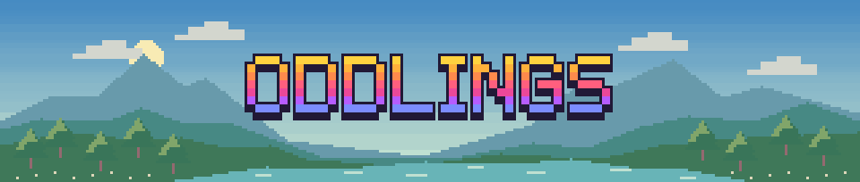
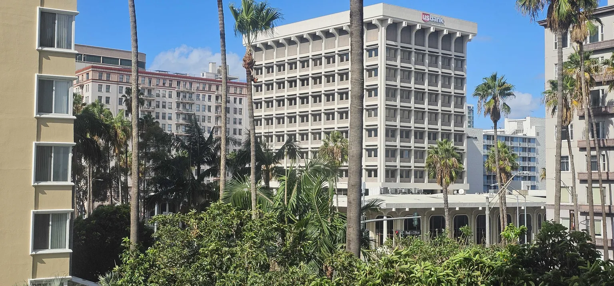
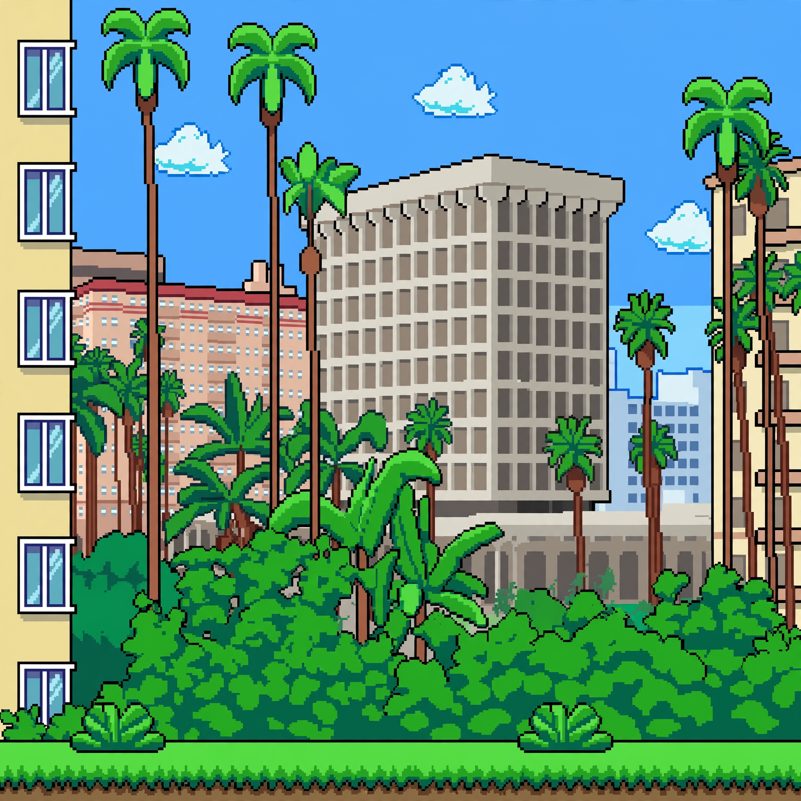
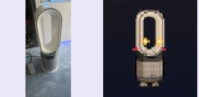
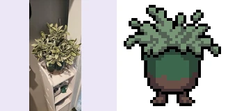
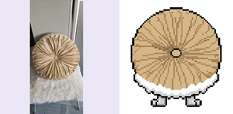
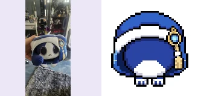
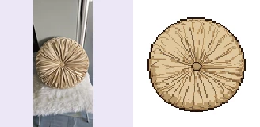
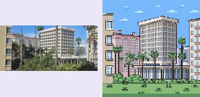

<p align="center">
  <a href="https://oddlings-meta.ai.studio/"></a>
</p>

# Oddlings

**Your camera is the character creator.** Photograph an object you know, hatch it as a pixel companion, and build a world it can live in. A tower fan became Halobreeze, a companion with an oval halo and a wind-themed ability.

**Meta Global AI Developer Hackathon 2026 · Indie Developer · Build for Your World**

**[▶ Play Oddlings](https://oddlings-meta.ai.studio/)** · [Photo results](#first-photo-check) · [Reviewer guide](docs/REVIEWER-GUIDE.md) · [Run locally](#run) · [License](LICENSE)

| [Indie track criterion](https://dev.meta.ai/events/global-hackathon) | What Oddlings delivers | Where to verify |
| --- | --- | --- |
| **Creativity** | Objects from your own space become companions you can care for, talk to, and bring into a habitat you build. Fusion gives two discoveries a shared descendant with recorded lineage. | [First photo check](#first-photo-check) · [Fusion Lab source](src/components/FusionLab.tsx) |
| **Technical ambition** | Two Meta models turn photos into playable creatures and fuse pairs into hybrids with recorded lineage. Residents remember interactions and send players on photo quests. A persistent habitat stores player edits, while a shared job system handles model calls, retries, and limits. | [Architecture and code](docs/REVIEWER-GUIDE.md#from-a-photo-to-a-playable-creature) · [Model routes](docs/REVIEWER-GUIDE.md#model-routes) |
| **Works in the game** | A live fan photo went through recognition, incubation, hatch, claim, and reload. The same evidence batch includes four creature results, an item drawing, and an AI backdrop. The tested source passed 151 automated tests, TypeScript, and the production build. | [Play the live build](https://oddlings-meta.ai.studio/) · [Photo evidence](#first-photo-check) · [Verification and scope](docs/REVIEWER-GUIDE.md#what-was-verified) |

## Your first adventure

**See a result right away.** Enter the habitat and choose **Create Biome → Sample landscape** to see a city photo beside the actual Muse Image backdrop the game generated. For a live model run, use **Incubator** with your own object photo.

1. **📸 Snap.** Open the **Incubator** and upload or take a photo of an everyday object.
2. **🥚 Hatch.** Give the egg 30 seconds, then crack it open and name your Oddling.
3. **💗 Care.** Give it a treat, play, or chat. Try its special ability and take on a photo quest.
4. **🧬 Fuse.** Combine two Oddlings in the **Fusion Lab**. The parents stay with you, and the **Collection** records the hybrid’s lineage.
5. **🧱 Build.** Paint terrain and place decorations in **Build / Edit Biome**. Try **Create Biome → Sample landscape** to see what a real photo looks like as game scenery.

> ✨ **Starter pouch:** 500 Sparkles, 10 Life Seeds, and 5 Craft Gems in a fresh save. Finish all four **First-Run Goals** to claim another **50 Sparkles** once.

## From city photo to pixel world

| 📷 Original photo | ✨ Muse Image backdrop |
| --- | --- |
|  |  |

The game generated this backdrop through its Meta biome-art route. The sample uses the saved pair, so you can see the result as soon as the images load.

## Where Meta AI comes in

- **Muse Spark Open** reads your photo and designs the Oddling’s traits. It also powers conversations, photo quest checks, and fusion traits.
- **Muse Image** draws creatures, hybrid artwork, placeable photo items, and photo biome scenery.
- **Oddlings** handles the game rules. It turns generated traits into abilities, keeps track of saves, and manages the world you build.

### What Oddlings builds around the models

- **Photo to playable creature.** Muse Spark Open extracts the object's identity and proposes traits and an ability. Muse Image draws from the original photo. Oddlings maps the ability to a defined game effect such as watering seeds or restoring energy. Fusion sends both parents' traits to Muse Spark and both parents' images to Muse Image, then saves the hybrid's lineage. [Incubator](src/components/IncubatorLab.tsx) · [Fusion Lab](src/components/FusionLab.tsx)
- **Residents that remember.** Chat uses the resident's recent memories, mood, friendship, and the current weather. In photo quests, Muse Spark checks a new real-world photo against the creature's request. A match changes the resident's trust and energy and adds a memory. [Creature chat](src/components/CreatureChat.tsx) · [Photo quests](src/components/PhotoQuest.tsx)
- **A world players can reshape.** Photos can become scenery or placeable items. Players edit terrain, move residents between saved areas, and use abilities in the habitat. The Garden Adventure records which residents helped a seed bloom. Terrain rendering caches each region as an image so ordinary interactions can reuse it. [Terrain renderer](src/components/BiomeWorldRenderer.tsx) · [Garden Adventure](src/game/gardenAdventure.ts)
- **AI jobs that can fail cleanly.** Shared Redis storage holds background job results and enforces request limits across server instances. Creature recognition retries eligible failures once. Photo items also retry if a local silhouette check rejects the drawing. When a reserved action fails, the game returns the applicable resource and tells the player what happened. [Shared AI store](server/sharedAiStore.ts) · [Photo item quality checks](src/game/itemArtQuality.ts) · [Failure tests](server/sharedAiStore.test.ts)

### How the art is made

| In the game | What makes it |
| --- | --- |
| **Muse Image artwork** | Meta draws creatures, items, fusions, and AI biomes from supplied images. Oddlings prepares the result for the game. |
| **Photo-based fallback** | Oddlings traces the source photo into a pixel sprite when creature artwork is unavailable. Photo items also offer the player's photo as a separate option. |
| **Local biome conversion** | The browser pixelates the photo on the device. The AI scenery option sends a compressed photo to Muse Image. |

### First photo check

Four creator photos were picked before testing on November 4, 2026. Each went through recognition once, including its built-in retry if triggered. The fan hatched in the browser. The other three used the game's recognition client and live artwork routes. Each pair shows the source photo on the left.

| Photo and result | Recognition | What the run showed |
| --- | --- | --- |
|  | **Halobreeze**, bladeless tower fan/air purifier | Hatched and claimed with one Life Seed spent. The creature and balance persisted after reload. This run exposed an incorrect “fork” label. The fix is in the live build and has a regression test. |
|  | **Sagepuff**, faux potted plant | Automatic recognition retry ran once. The first artwork kept the leafy silhouette and pot. |
|  | **Ploofina**, round tufted throw pillow | No recognition retry. The first artwork kept the radial pattern and added feet. |
|  | **Hoodleplume**, hooded plush doll | No recognition retry. The first artwork kept the hood colors and trim, but dropped much of the face. |

| More from the same check | First result |
| --- | --- |
| **Photo item** · round patterned cushion |  The item artwork route returned a drawing with the radial pattern. |
| **AI biome** · city and palms |  The biome route returned a pixel scene with the palm trees and building silhouettes. |

The item and biome rows show first server drawings. The browser's item silhouette check and in-game placement are separate steps. Source thumbnails are resized copies of the creator's photos without embedded camera metadata.

## Evidence: real photos to Oddlings

The earlier five-photo run records the recognized objects, generated creatures, and measured model times. [Five-photo evidence](docs/REVIEWER-GUIDE.md#evidence-real-photos-to-oddlings) · [Live and automated verification](docs/REVIEWER-GUIDE.md#what-was-verified)

## Run

Use a Node version supported by the pinned Vite dependency. Install dependencies with `npm install` (or `pnpm install`). Copy `.env.example` to `.env` and set the keys you have:

| Secret | Used for |
|---|---|
| `BASETEN_API_KEY` | Recognition, fusion, diary/speech, sprite review |
| `FIREWORKS_API_KEY` | Talk, creature banter, photo quests |
| `META_API_KEY` (or `MODEL_API_KEY`) | Muse Image creature artwork |

Never commit `.env`. In Google AI Studio these are set under Settings → Secrets.

```sh
npm run dev
```

Open the localhost address printed by the server (default port 3000). Without keys, local gameplay and manual/demo modes work, and each live feature returns a clear configuration error. Model calls use provider credits and may incur provider charges.

```sh
npm run lint
npm test
npm run build
```

Integration tests use `ODDLINGS_TEST_URL` when set, otherwise port 3000. Use unset keys for automated tests so no paid inference is requested. In production, build first, set `NODE_ENV=production`, provide the keys as server environment secrets, and run `npm start`. Host the Express server, not only the static `dist` folder; the browser needs its server API routes.

For server limits, production setup, and third-party photo credits, see the [reviewer guide](docs/REVIEWER-GUIDE.md).
